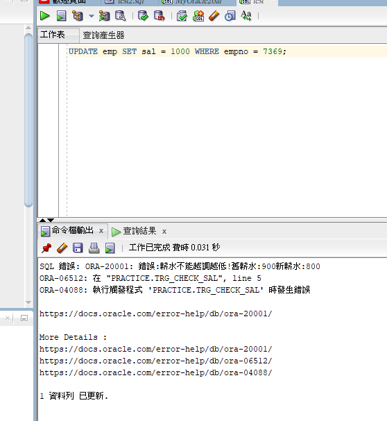

Markdown
# Oracle PL/SQL 企業人事管理模組 (HR Management Module)

## 專案簡介
本專案模擬企業 ERP 系統中的人事 (HR) 模組，使用 Oracle PL/SQL 進行客製化開發。包含員工資料的 CRUD 操作、薪資異動的商業邏輯防呆，以及跨部門資料的檢視表設計。

## 技術標籤
* **Database:** Oracle 
* **Language:** SQL, PL/SQL
* **Objects:** Package, Stored Procedure, Function, Trigger, View, Cursor

## 核心功能與商業邏輯
1. **員工資料管理 (Package `emptools`)**
   * 使用帶參數的 Cursor 批次印出特定部門員工。
   * 封裝 Procedure 處理員工離職 (刪除資料並 Commit)。
   * 實作 Function 計算調薪百分比並更新資料庫。
2. **薪資異動防呆機制 (Trigger `trg_check_sal`)**
   * **商業邏輯：** 防止人資系統誤植，系統會自動攔截「新薪水低於舊薪水」的 `UPDATE` 操作，並拋出自訂錯誤 (ORA-20001)。
3. **資料權限控管 (View `v_emp_dept10`)**
   * 針對特定部門建立 View，隱藏薪資等敏感欄位，僅供一般行政人員查詢。

## 實際操作展示
**1. 薪資防呆觸發測試 (阻擋降薪)**

**2. 員工調薪與部門檢索成功**

